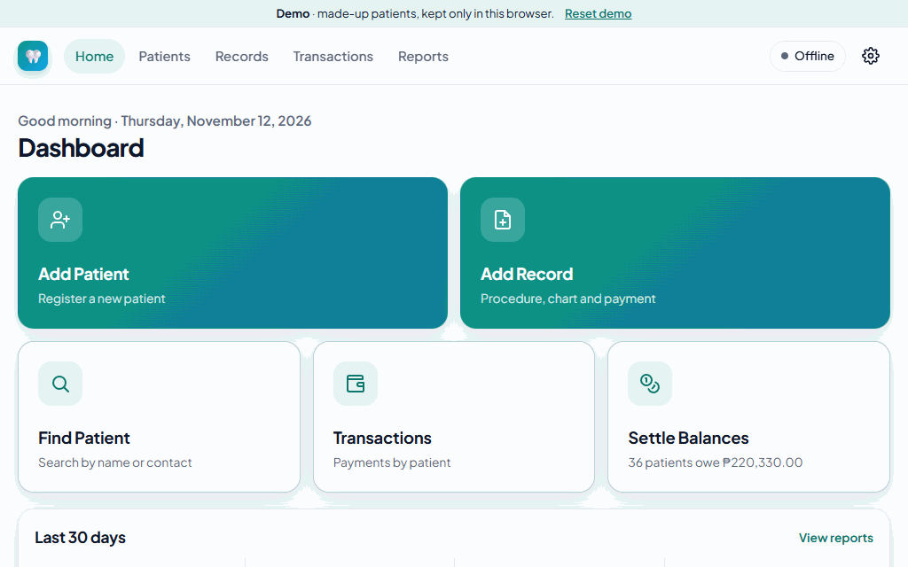
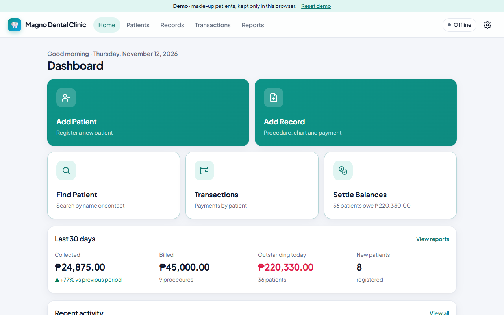
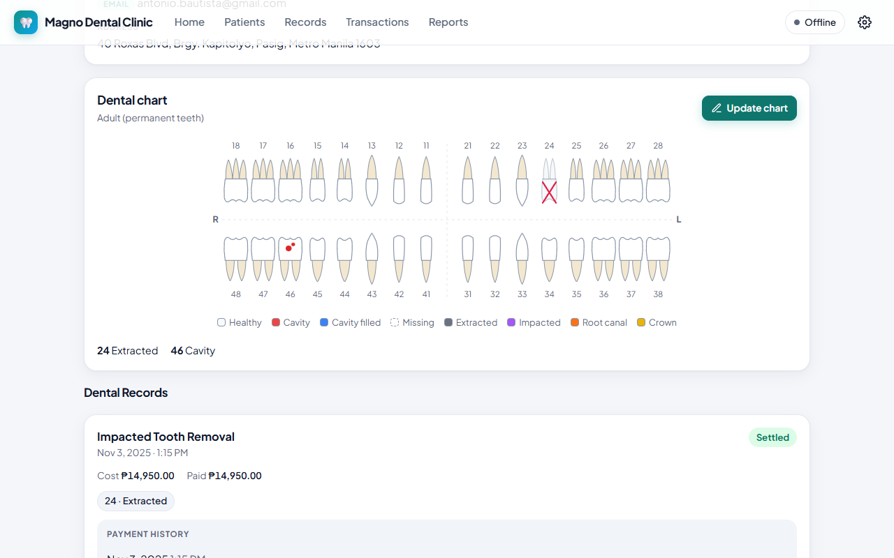
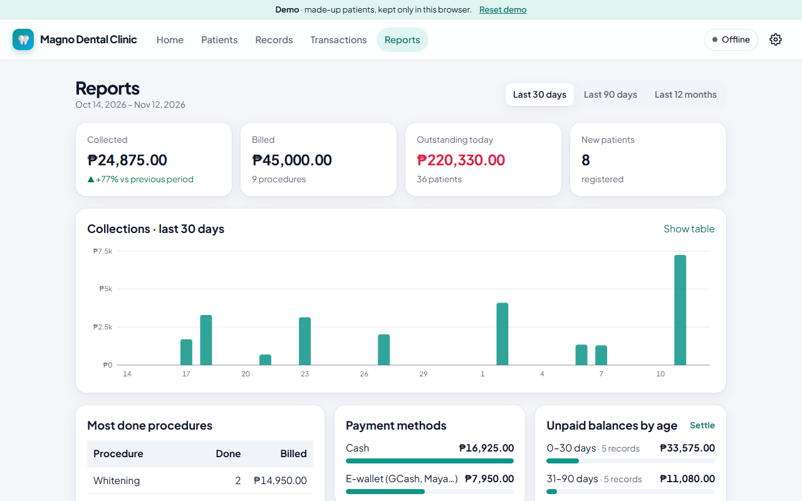
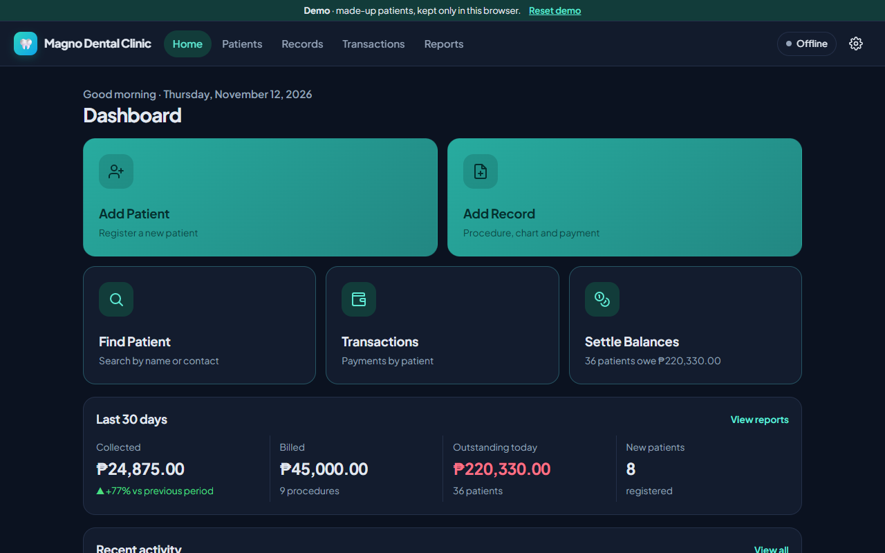
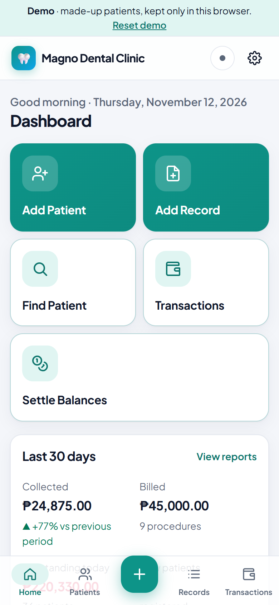
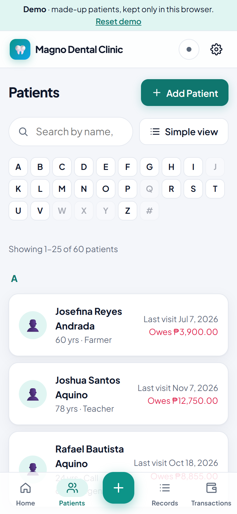

# Magno Dental Clinic

[](https://github.com/arfmagno/dental-clinic-mgt-system/actions/workflows/ci.yml)
[](https://github.com/arfmagno/dental-clinic-mgt-system/releases)


Patient records, FDI dental charts, procedures and payments for a small dental clinic. It is **offline-first**: everything is saved on the device, the clinic keeps working with no internet, and devices sync through a server the clinic hosts once sync is switched on. It runs as an installable web app (PWA) and as a **Windows desktop program** with its own installer.

**[Try the demo →](https://arfmagno.github.io/dental-clinic-mgt-system/)** It runs entirely in your browser with 60 made-up patients. Choose any PIN; *Reset demo* starts over.



## What it does

- **Patients:** name parts (full name derived), date of birth, nationality, contacts with country codes (one primary), address, photo (camera or upload, cropped on the device), accent-insensitive search, A–Z grouped pages, PDF export.
- **Dental chart:** an anatomically drawn FDI odontogram (permanent, primary or mixed teeth by classification), conditions drawn on each tooth, full history ("view the chart as it was at this visit").
- **Procedures and payments:** saving a procedure always records the matching chart change; payments are itemised per procedure and balances are derived, never stored. Settle one record or several at once.
- **Staff:** a PIN lock, a patient-facing registration mode that cannot reach other records, and per-person accounts with an activity log on devices that sync.
- **Reports** (optional, off by default): collections, unpaid balances by age, most common procedures.
- **Backups** encrypted with a passphrase; restore merges without overwriting anything newer.

| | |
| --- | --- |
|  |  |
|  |  |

<p align="center"> </p>

## What's interesting here

- **Offline-first sync that is generic and testable.** Every table carries `id`, `createdAt`, `updatedAt` and `isDeleted`. The device pushes dirty rows and pulls a paged change feed, with last-write-wins per row. A row edited while its push is in flight stays dirty, and rows the server refuses stay pending with the reason shown. A new table only has to be declared in `SYNC_TABLES`. [Architecture →](docs/ARCHITECTURE.md)
- **Security that says what it does not do.** Staff accounts sync so people can sign in on any device offline, so the server cannot simply trust devices: it enforces who may change accounts (an admin with a PIN-verified staff token), keeps the audit log append-only, and writes each audit entry in the same transaction as its change. Backups use AES-256-GCM. [SECURITY.md](docs/SECURITY.md) lists the threat model and the accepted limits, for example why data at rest on a device is not encrypted.
- **Layered on both sides.** The server has routes, services, a domain and repositories behind a `SqlDriver` port (SQLite today) with a default-deny auth gate. The client has pages, hooks, services, a domain and Dexie, so business rules are plain functions with tests. Validation rules are shared by the app and the server.
- **Migrations you can trust.** Migrations are timestamped `.sql` or `.ts` files that run in order. They take a backup first, check foreign keys, and come with a generator and a naming lint. [MIGRATIONS.md](docs/MIGRATIONS.md)
- **Quality gates in CI:**
  - 105 unit and integration tests (server, web on fake IndexedDB, desktop) with a coverage floor;
  - 31 Playwright end-to-end tests against the real server and production build, including offline reloads and sync;
  - axe accessibility checks on every page in light and dark mode;
  - a Lighthouse audit with score floors.
- **One codebase, three shells:** a PWA served by the API, an Electron app that loads the build from disk and forwards `/api` to the clinic's server (no CORS, LAN `http` works), and a static demo build with no server at all.

Design decisions and their trade-offs: [docs/DECISIONS.md](docs/DECISIONS.md).

## Quick start (development)

Requires Node.js 20+.

```bash
npm install
npm run dev          # API on :3001, web app on http://localhost:5173
```

On first open, create a staff PIN. For sample data (60 made-up patients with visits, payments and charts), run `npm run seed` against the dev server (`-- --remove` to undo) and switch sync on in **Settings → Sync** with the dev password `clinic`. Production rejects that password.

```bash
npm run check        # lint + typecheck + unit tests
npm run coverage     # web unit tests with the coverage floor
npm run e2e          # Playwright: production build + real server (Edge locally, Chromium in CI)
npm run build        # production web build (includes the service worker)
npm run build:demo   # the static demo (services/web/dist-demo)
npm run lighthouse   # Lighthouse audit of the production build (after npm run build)
npm run migration:new -- <description> [--ts]
```

## Install and host

- **Server:** one Node.js process and one SQLite file. It runs in Docker (the image is published to GHCR on each release) or on the clinic computer with `start-clinic.bat`. See [HOSTING.md](docs/HOSTING.md).
- **Windows:** `npm run dist:desktop`, then run `Magno-Dental-Clinic-Setup-<version>.exe` on each computer. Installers are also attached to each [GitHub release](https://github.com/arfmagno/dental-clinic-mgt-system/releases).
- **Any device:** open the hosted address in Chrome or Edge and choose **Install**. It then opens with no internet.

## Documentation

| Doc | What it covers |
| --- | --- |
| [ARCHITECTURE.md](docs/ARCHITECTURE.md) | Layers, data model, sync protocol, lock stages, security model, roadmap hooks |
| [SECURITY.md](docs/SECURITY.md) | Threat model, controls, known limits, the clinic's checklist |
| [DECISIONS.md](docs/DECISIONS.md) | The main design decisions, the alternatives and why |
| [CODE_GUIDE.md](docs/CODE_GUIDE.md) | Module-by-module reference and "how do I add X" recipes |
| [MIGRATIONS.md](docs/MIGRATIONS.md) | Adding tables and columns and moving data safely |
| [HOSTING.md](docs/HOSTING.md) | Deploying, environment variables, staff accounts, backups |
| [SPEC_CHECKLIST.md](docs/SPEC_CHECKLIST.md) | Every requested item, where it lives and how it was verified |
| [CHANGELOG.md](CHANGELOG.md) · [RELEASE_NOTES.md](docs/RELEASE_NOTES.md) | What changed, technically and for the clinic |

## Automation

| Workflow | When | What |
| --- | --- | --- |
| `ci.yml` | Every push to `master` and pull request | Lint, typecheck, unit tests and coverage; end-to-end and accessibility tests; Lighthouse |
| `release.yml` | A tag `vX.Y.Z` matching `package.json` | Checks, then the Windows installer on a GitHub Release and the server image on GHCR |
| `demo.yml` | Version tags, or on demand | Builds the demo and publishes it to GitHub Pages |
| `dependabot.yml` | Mondays | Dependency and Actions updates (`better-sqlite3` stays on v11) |

## Repository layout

```
services/api      Fastify API + SQLite (swappable), migrations, sync, auth, scripts
services/web      React PWA: IndexedDB (Dexie), UI, PDF export, demo build
services/desktop  Electron shell + Windows installer
shared/           Domain types, vocabularies, tooth catalog, validation, sync tables, sample data
e2e/              Playwright specs (including accessibility)
docs/             Documentation
```

## Sample data

All patients in the demo and the sample data are made up.
